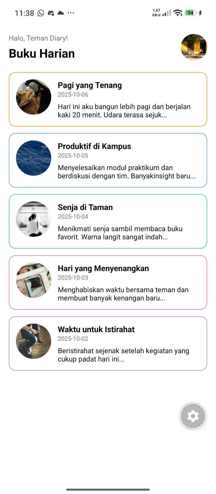

# Diary App - Buku Harian

## Identitas Mahasiswa
- **Nama:** Salwa Salsa Nabilah
- **NIM:** 2430511021
- **Mata Kuliah:** Mobile Multi Platform
- **Program Studi:** Teknik Informatika
- **Universitas:** Universitas Muhammadiyah Sukabumi

## Deskripsi Aplikasi
Diary App merupakan aplikasi buku harian sederhana yang dibuat menggunakan React Native dan Expo. Aplikasi ini menampilkan beberapa catatan harian yang berisi judul, tanggal, ringkasan cerita, dan gambar.

## Fitur Aplikasi
- Menampilkan lima entri diary.
- Menggunakan gambar lokal Jayen dari folder `assets/moods`.
- Menampilkan avatar pada bagian header.
- Memiliki warna border kartu yang berbeda berdasarkan mood.
- Menggunakan komponen `DiaryCard` agar kode dapat digunakan kembali.
- Menggunakan komponen `View`, `Text`, `Image`, dan `ScrollView`.
- Menggunakan `StyleSheet` dan Flexbox untuk mengatur tampilan.
- Dapat dijalankan melalui Expo Go.

## Struktur Folder
- `assets/moods/` untuk menyimpan gambar lokal.
- `src/components/` untuk menyimpan komponen `DiaryCard`.
- `src/screens/` untuk menyimpan halaman `DiaryListScreen`.
- `App.js` sebagai file utama aplikasi.
- `screenshots/` untuk menyimpan screenshot aplikasi.

## Cara Menjalankan Aplikasi
1. Pastikan Node.js dan npm sudah terpasang.
2. Buka terminal pada folder proyek `diary-app`.
3. Jalankan perintah `npm install` jika dependency belum terpasang.
4. Jalankan aplikasi dengan perintah `npx expo start`.
5. Buka Expo Go pada smartphone.
6. Pindai QR code yang muncul di terminal.
7. Pastikan aplikasi berhasil dibuka dan tampil tanpa error.

## Screenshot Aplikasi
Berikut tampilan Diary App yang dijalankan melalui Expo Go.

## Teknologi yang Digunakan
- React Native
- Expo CLI
- JavaScript
- Visual Studio Code
